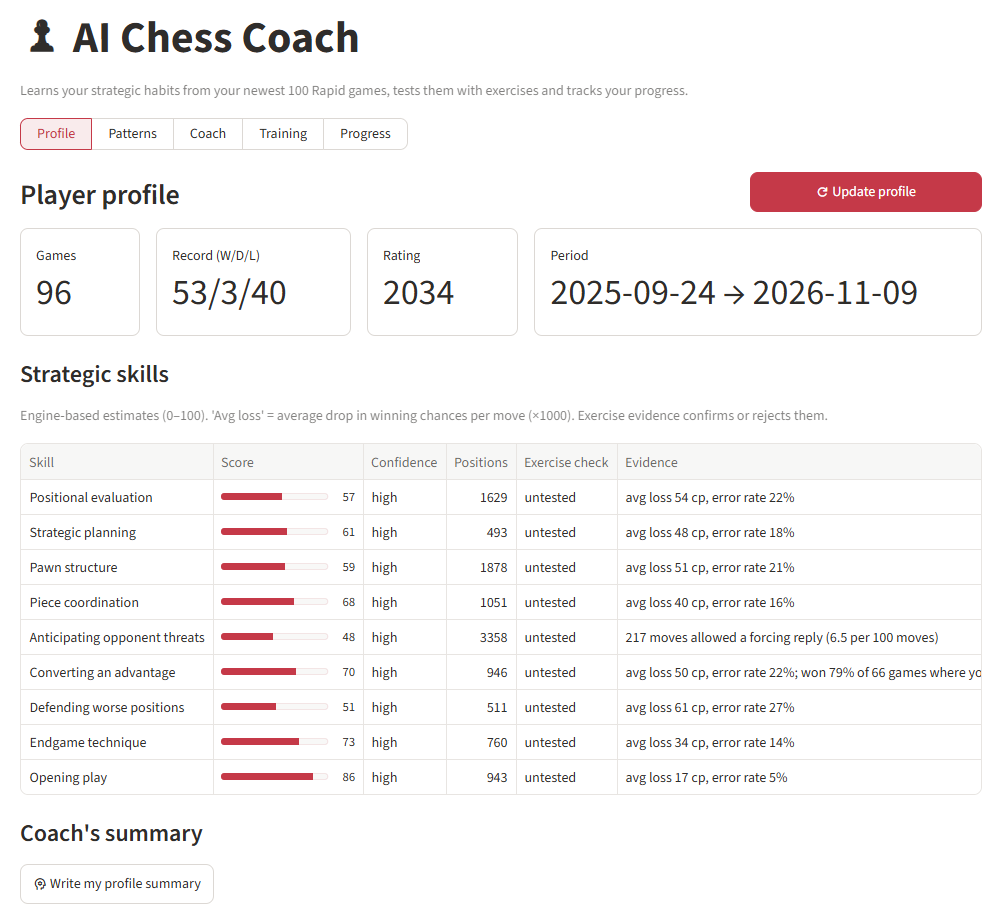
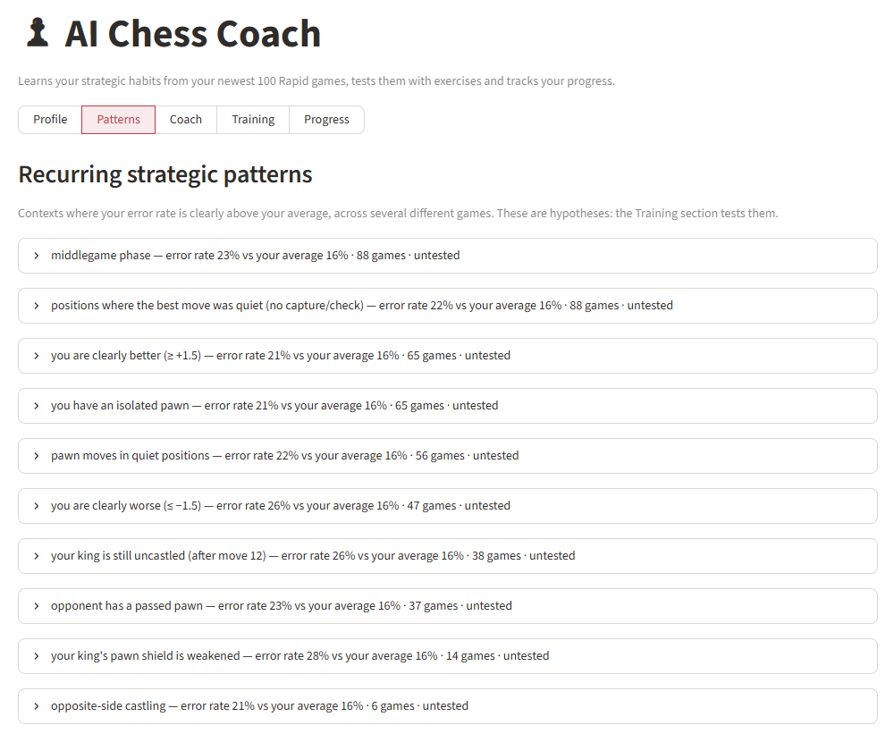

# Chess Improvement Agent (MVP)

A local Streamlit app that imports my public Chess.com games, analyses every move with Stockfish, builds a profile of strategic weaknesses, and tests those weaknesses with personalised exercises. An optional Claude-based coach writes the questions, grades the explanations and explains positions.

The idea: a PGN shows *what* was played, not *why*. So every weakness the app finds is treated as a **hypothesis** that has to be confirmed or rejected by exercises, not as a verdict.

## Screenshots

**Profile**: skill scores from ~100 of my own Rapid games, with the evidence behind each score.



**Patterns**: contexts where my error rate is above my own average. Each one is a hypothesis for the Training section.



## How it works

1. **Import**: downloads the public Chess.com archive (or reads a PGN) and stores games in SQLite.
2. **Engine analysis**: Stockfish (UCI via `python-chess`) evaluates every position. A move's cost is the **drop in expected score** (Lichess win-probability model, ×1000) instead of raw centipawns, so mate scores and already-decided positions don't distort the numbers.
3. **Features**: each position gets explainable tags (isolated/doubled/passed pawns, open or closed centre, king safety, loose pieces, mobility, game phase …), and each costly move gets a rough cause: missed threat, missed opportunity or strategic error.
4. **Pattern detection**: finds contexts where my error rate is clearly above my own baseline (≥ 1.3×, ≥ 20 positions, spread over several games).
5. **Exercises**: positions from those patterns (re-checked with a deeper multi-PV search), plus a hidden *control* position from the same context where I played well.
6. **Verification**: each answer is scored by the engine (move) and, if an API key is set, by Claude (reasoning). The average per pattern marks it as *confirmed weakness*, *mixed* or *not confirmed*.
7. **Progress**: profile snapshots and exercise attempts are kept over time.

## What is ML / LLM and what is rule-based

- **Stockfish**: neural-network evaluation (NNUE), used as an external engine.
- **Claude API**: question generation, grading of free-text explanations (structured JSON output), profile summary and coach chat. Without an API key the app uses rule-based text.
- **Rule-based / statistical**: position tags, error classes, skill scores, pattern detection and verification thresholds. No model is trained in this project.

## Setup

Requires Python 3.10+.

```bash
python -m venv .venv
# Windows: .venv\Scripts\activate    macOS/Linux: source .venv/bin/activate
pip install -r requirements.txt
```

**Stockfish**: download it from https://stockfishchess.org/download/ and either put it on your PATH or enter the path to the executable in the app sidebar. The binary is not part of this repo.

**Claude (optional)**: set `ANTHROPIC_API_KEY` as an environment variable or paste the key in the sidebar. Never commit the key.

```bash
streamlit run app.py
```

Data is written to `data/coach.db` (git-ignored, it contains personal game data).

## Project structure

| File | Role |
|---|---|
| `app.py` | Streamlit UI |
| `src/chesscom.py` | Chess.com public API client |
| `src/analyzer.py` | Stockfish analysis, win-probability loss, error classification |
| `src/features.py` | Strategic position tags |
| `src/profile.py` | Skill scores, pattern detection, verification |
| `src/training.py` | Exercise generation and move evaluation |
| `src/coach.py` | Claude coach with rule-based fallback |
| `src/store.py` | SQLite persistence |
| `src/pipeline.py` | Import + analysis pipeline |

## AI assistance

This project was built with AI assistance: I used **Claude Code** as a coding partner for implementation and refactoring. The coach feature itself calls the Claude API at runtime (optional, see Setup).

## Known limitations

- The control position is generated but not yet compared separately against the error positions; verification uses a simple average with fixed thresholds (no statistical test).
- Exercises reuse positions from my own games, so recall of the position can inflate scores.
- Exercise move scoring still uses raw centipawn difference, unlike the game analysis.
- Error causes and tags are heuristics, not ground truth. Mainline only, no variations.
- No automated tests yet.

## Ideas

- A logistic-regression model predicting errors from all tags together, to separate overlapping contexts.
- Use the control positions in verification (error vs. control score difference).
